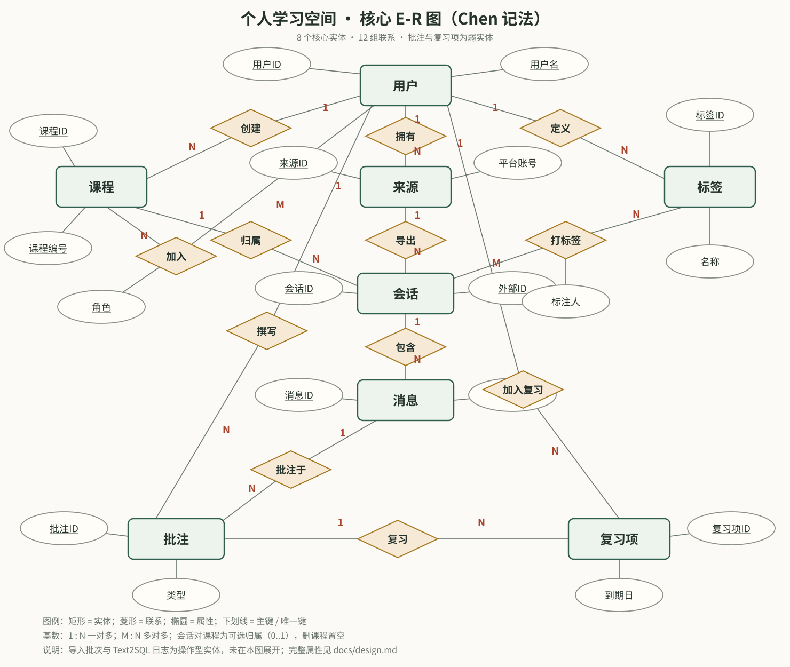

# 数据库设计说明

本文档说明「个人学习空间」的概念模型、关系模式、范式分析、完整性约束、索引、权限视图与事务边界。DDL 以 `sql/schema.sql`、`sql/views.sql`、`sql/roles.sql` 为准；文中只摘录关键部分。

## 1. 设计目标与边界

系统围绕一条学习链路建模：

> 平台来源 → 会话 → 消息 → 批注 → 复习项

同时用课程、标签、课程成员组织内容，用导入批次记录“文件如何进入数据库”，用 Text2SQL 日志记录“自然语言查询如何被审计”。

设计边界：

- 不保存真实用户的聊天导出；全部聊天内容为模拟数据。
- 不保存密码明文；只保存 PBKDF2 哈希。
- 管理员不读取他人消息正文、批注与复习内容。
- 不引入 ORM、向量库、消息队列；所有关键 SQL 可在服务层和 `sql/` 中直接定位。
- 单机部署，不追求分布式事务；通过唯一键、行锁与 advisory lock 保证单库并发正确性。

## 2. 概念模型（E-R）

教材风格 Chen 记法见 [er-chen.svg](er-chen.svg)（PNG 版 [screenshots/16-er-chen.png](screenshots/16-er-chen.png)）。核心 8 个实体、12 组联系：



Mermaid 版本见 [er.mmd](er.mmd)，便于在支持 Mermaid 的编辑器中查看。操作型实体 `import_batches`、`text2sql_log`、`review_logs`、`api_tokens` 未画入核心图，但存在于关系模式中；`review_logs` 通过用户/复习项与核心模型相连。

### 2.1 核心基数

| 联系 | 基数 | 说明 |
| --- | --- | --- |
| 用户 — 课程（创建） | 1:N | 一门课只有一个创建者 |
| 用户 — 课程（加入） | M:N | 通过 `course_members` 携带 owner/editor/viewer |
| 用户 — 来源 | 1:N | 一个用户可有多个平台账号 |
| 来源 — 会话 | 1:N | 同一来源下的外部会话 ID 唯一 |
| 课程 — 会话 | 1:N，可选 | 会话可以暂时不归类；删课程置空 |
| 会话 — 消息 | 1:N | `(conversation_id, seq_no)` 唯一 |
| 用户 — 标签 | 1:N | 标签属于个人，不跨用户共享 |
| 会话 — 标签 | M:N | 通过 `conversation_tags`，带标注人与时间 |
| 消息 — 批注 | 1:N | 一条消息可有多条批注 |
| 用户 — 批注 | 1:N | 批注必须由有编辑权限的用户撰写 |
| 批注 — 复习项 | 1:N | 同一批注可被多个有权限的用户各自复习 |
| 用户 — 复习项 | 1:N | 每人独立的复习队列 |

批注与复习项在 E-R 图中标为弱实体：它们的身份依赖于消息 / 批注，删除上级对象时级联删除。

## 3. 关系模式

15 张表全部位于 `app` schema（12 张基线表 + 迁移新增的 `review_logs`、`api_tokens`、`tag_edges`）。

### 3.1 用户 `users`

| 列 | 类型 | 约束 |
| --- | --- | --- |
| id | bigint identity | PK |
| username | varchar(50) | UNIQUE、非空、格式 `^[A-Za-z0-9_]{3,50}$` |
| password_hash | text | 非空、长度 ≥ 32 |
| display_name | varchar(100) | 非空、去空格后非空 |
| system_role | varchar(10) | `student` / `admin` |
| is_active | boolean | 默认 true；停用代替删除 |
| created_at | timestamptz | 默认 now() |

### 3.2 课程 `courses`

| 列 | 类型 | 约束 |
| --- | --- | --- |
| id | bigint identity | PK |
| code | varchar(20) | 非空、格式 `^[A-Za-z0-9-]{2,20}$` |
| name | varchar(100) | 非空 |
| semester | varchar(20) | 非空 |
| instructor / description | varchar / text | 可空 |
| created_by | bigint | FK → users(id) ON DELETE RESTRICT |
| created_at | timestamptz | 默认 now() |

`UNIQUE (created_by, code, semester)`：同一创建者在同一学期不能重复建同编号课程。

### 3.3 课程成员 `course_members`

| 列 | 类型 | 约束 |
| --- | --- | --- |
| course_id | bigint | FK → courses(id) ON DELETE CASCADE |
| user_id | bigint | FK → users(id) ON DELETE CASCADE |
| role | varchar(10) | `owner` / `editor` / `viewer` |
| joined_at | timestamptz | 默认 now() |

`PRIMARY KEY (course_id, user_id)`；部分唯一索引 `course_members_one_owner ON (course_id) WHERE role = 'owner'` 保证每门课最多一个 owner；延迟约束触发器保证事务结束时**恰好**一个 owner。

### 3.4 来源 `sources`

| 列 | 类型 | 约束 |
| --- | --- | --- |
| id | bigint identity | PK |
| owner_id | bigint | FK → users(id) ON DELETE CASCADE |
| platform | varchar(20) | `qoder` / `chatgpt` / `deepseek` / `claude` / `other` |
| account_label | varchar(100) | 默认 `default` |
| created_at | timestamptz | 默认 now() |

`UNIQUE (owner_id, platform, account_label)`：同一用户的同一平台账号只建一条来源。

### 3.5 导入批次 `import_batches`

| 列 | 类型 | 约束 |
| --- | --- | --- |
| id | bigint identity | PK |
| user_id | bigint | FK → users(id) ON DELETE CASCADE |
| source_id | bigint | FK → sources(id) ON DELETE RESTRICT |
| file_name | varchar(255) | 非空 |
| file_sha256 | char(64) | 非空、64 位小写十六进制 |
| file_size | integer | 1 B – 5 MB |
| status | varchar(10) | `preview` / `imported` / `failed` / `expired` |
| preview_token | uuid | UNIQUE |
| payload | jsonb | 可空；仅预览期保存解析结果，导入成功后置 NULL |
| summary | jsonb | 非空、必须是 JSON 对象 |
| created_at / expires_at | timestamptz | `expires_at > created_at` |
| imported_at | timestamptz | 可空 |

这是一张操作型/暂存表，用于跨请求保存预览状态，避免把解析结果放在进程内存中。

### 3.6 会话 `conversations`

| 列 | 类型 | 约束 |
| --- | --- | --- |
| id | bigint identity | PK |
| source_id | bigint | FK → sources(id) ON DELETE RESTRICT |
| course_id | bigint | FK → courses(id) ON DELETE SET NULL |
| external_id | varchar(200) | 非空、去空格后非空 |
| title | varchar(255) | 非空 |
| started_at / ended_at | timestamptz | 可空；`ended_at >= started_at` |
| is_archived | boolean | 默认 false |
| created_at | timestamptz | 默认 now() |

`UNIQUE (source_id, external_id)`：同一来源内外部会话 ID 唯一，是重复导入去重的依据。

### 3.7 消息 `messages`

| 列 | 类型 | 约束 |
| --- | --- | --- |
| id | bigint identity | PK |
| conversation_id | bigint | FK → conversations(id) ON DELETE CASCADE |
| seq_no | integer | `> 0` |
| sender | varchar(10) | `user` / `assistant` / `system` |
| content | text | 去空格后非空 |
| created_at | timestamptz | 默认 now() |
| embedding | vector(1536) | 可空；迁移 004 新增，仅混合检索启用时写入 |
| embedding_model / embedded_at | text / timestamptz | 可空；记录向量来源与时间，便于重算 |

`UNIQUE (conversation_id, seq_no)`：会话内消息序号唯一；重复导入时 `ON CONFLICT DO NOTHING`。向量列是派生数据，不属于业务范式讨论；它不参与任何唯一键，删除后可由 `scripts/embed_messages.py` 重新生成。

### 3.8 标签 `tags`

| 列 | 类型 | 约束 |
| --- | --- | --- |
| id | bigint identity | PK |
| owner_id | bigint | FK → users(id) ON DELETE CASCADE |
| name | varchar(50) | 非空 |
| kind | varchar(20) | `knowledge_point` / `topic` / `custom` |
| color | varchar(7) | `^#[0-9A-Fa-f]{6}$` |
| created_at | timestamptz | 默认 now() |

`UNIQUE (owner_id, name)`：标签是个人资产，同名标签在用户内唯一。

### 3.9 会话标签 `conversation_tags`

| 列 | 类型 | 约束 |
| --- | --- | --- |
| conversation_id | bigint | FK → conversations(id) ON DELETE CASCADE |
| tag_id | bigint | FK → tags(id) ON DELETE CASCADE |
| created_by | bigint | FK → users(id) ON DELETE CASCADE |
| created_at | timestamptz | 默认 now() |

`PRIMARY KEY (conversation_id, tag_id)`。触发器校验：标签必须属于标注人；标注人必须是会话所有者或课程 owner/editor。

### 3.10 批注 `annotations`

| 列 | 类型 | 约束 |
| --- | --- | --- |
| id | bigint identity | PK |
| message_id | bigint | FK → messages(id) ON DELETE CASCADE |
| user_id | bigint | FK → users(id) ON DELETE CASCADE |
| kind | varchar(15) | `note` / `question` / `correction` / `summary` |
| content | text | 去空格后非空 |
| status | varchar(10) | `open` / `resolved` |
| created_at / updated_at | timestamptz | `updated_at` 由触发器维护 |

触发器校验：只有会话所有者或课程 owner/editor 能创建/迁移批注。

### 3.11 复习项 `review_items`

| 列 | 类型 | 约束 |
| --- | --- | --- |
| id | bigint identity | PK |
| user_id | bigint | FK → users(id) ON DELETE CASCADE |
| annotation_id | bigint | FK → annotations(id) ON DELETE CASCADE |
| status | varchar(10) | `pending` / `reviewing` / `mastered` |
| due_date | date | 默认 current_date |
| interval_days | integer | `> 0` |
| review_count | integer | `>= 0` |
| last_reviewed_at | timestamptz | 可空 |
| created_at | timestamptz | 默认 now() |

`UNIQUE (user_id, annotation_id)`：同一个人不能重复把同一批注加入队列；但不同用户可以各自复习同一批注，这是共享课程场景的刻意设计。

### 3.12 Text2SQL 日志 `text2sql_log`

| 列 | 类型 | 约束 |
| --- | --- | --- |
| id | bigint identity | PK |
| user_id | bigint | FK → users(id) ON DELETE CASCADE |
| question | text | 非空 |
| generated_sql | text | 可空；被拒绝或生成失败时可能为空 |
| status | varchar(10) | `success` / `rejected` / `error` |
| error_message | text | 可空 |
| latency_ms | integer | `>= 0` 或 NULL |
| row_count | integer | `>= 0` 或 NULL |
| created_at | timestamptz | 默认 now() |

`row_count`、`latency_ms` 是执行结果快照，属于审计意义上的受控冗余，不参与学习数据的一致性。

### 3.13 复习事件 `review_logs`（迁移 001）

| 列 | 类型 | 约束 |
| --- | --- | --- |
| id | bigint identity | PK |
| user_id | bigint | FK → users(id) ON DELETE CASCADE |
| review_item_id | bigint | FK → review_items(id) ON DELETE SET NULL |
| action | varchar(10) | `review` / `mastered` / `reset` |
| event_id | uuid | 可空；与 user_id 组成唯一键 |
| interval_days | integer | `> 0` |
| due_date | date | 非空 |
| review_count | integer | `>= 0` |
| created_at | timestamptz | 默认 now() |

`review_items` 只保存最新聚合状态，`review_logs` 记录每一次复习动作，供热力图、留存统计与离线 outbox 幂等重放使用。`UNIQUE (user_id, event_id)` 保证同一客户端事件只落一次；普通页面操作不传 `event_id`，不受影响。

### 3.14 采集令牌 `api_tokens`（迁移 003、006）

| 列 | 类型 | 约束 |
| --- | --- | --- |
| id | bigint identity | PK |
| user_id | bigint | FK → users(id) ON DELETE CASCADE |
| name | varchar(60) | 非空、去空格后 1–60 字符 |
| token_prefix | varchar(12) | 可读前缀，便于识别 |
| token_hash | bytea | UNIQUE；只存 SHA-256 |
| scopes | text[] | 默认 `{read,ingest}`；CHECK 为非空且是 `read/ingest/annotate` 的子集 |
| window_started_at | timestamptz | 当前固定窗口起点 |
| window_count | integer | `>= 0`，每分钟最多 60 次 |
| last_used_at | timestamptz | 可空 |
| created_at | timestamptz | 默认 now() |
| revoked_at | timestamptz | 可空；撤销后认证失败 |

令牌明文只在创建响应中返回一次；服务端不保存可逆密文。`(user_id, created_at DESC)` 索引用于令牌管理页。作用域由服务端逐端点校验：`read` 允许搜索与会话读取，`ingest` 允许写入统一 JSON，`annotate` 才允许 MCP 写批注；默认不授予写批注权限。

### 3.15 标签先修关系 `tag_edges`（迁移 005）

| 列 | 类型 | 约束 |
| --- | --- | --- |
| id | bigint identity | PK |
| from_tag_id | bigint | FK → tags(id) ON DELETE CASCADE |
| to_tag_id | bigint | FK → tags(id) ON DELETE CASCADE |
| created_at | timestamptz | 默认 now() |

- `UNIQUE (from_tag_id, to_tag_id)` 阻止重复边，`CHECK (from_tag_id <> to_tag_id)` 阻止自环，`(to_tag_id)` 索引支持反向“后继”查询。
- 表不冗余 `owner_id`：标签已带属主，边的属主由端点决定。触发器 `check_tag_edge_access` 要求两端标签属于同一用户，并用递归 CTE 检查 `to_tag_id` 是否已经可达 `from_tag_id`，是则拒绝插入，从而在数据库层保证有向无环图。
- 先修链查询使用递归 CTE；标签删除时边随外键级联删除。

## 4. 范式分析

### 4.1 第一范式（1NF）

所有列都是原子值。标签、课程成员、会话标签均使用关联表，不存逗号分隔字符串；消息正文整体作为 `text`，不在数据库内拆分句子。

### 4.2 第二范式（2NF）

所有实体表使用单列代理主键，不存在“非主属性依赖复合主键的一部分”：

- `course_members` 的非键属性 `role`、`joined_at` 依赖完整主键 `(course_id, user_id)`。
- `conversation_tags` 的非键属性 `created_by`、`created_at` 依赖完整主键 `(conversation_id, tag_id)`。

### 4.3 第三范式（3NF）与 BCNF

核心表无非主属性之间的传递依赖：

- `conversations` 不冗余 `owner_id`，通过 `source_id → sources.owner_id` 取得所有者；否则会引入 `conversation → source → owner` 的传递依赖。
- `messages` 不冗余课程、来源、所有者；这些信息通过会话关联取得。
- 不保存 `message_count`、`conversation_count` 等可派生计数；统计页全部实时 `COUNT`。
- `md5(content)` 使用表达式索引而不是生成列，避免 `id → content → content_hash` 的传递依赖；同时仍能支持跨会话查重。
- `courses.created_by` 表示“创建者”，`course_members(role='owner')` 表示“当前所有者”。两者语义不同，允许所有权转移，因此不构成冗余。
- `review_items.user_id` 与 `annotations.user_id` 表示不同的主体：批注作者与复习者。共享课程中两者可以不同。

候选键：

- `users(username)`
- `courses(created_by, code, semester)`
- `sources(owner_id, platform, account_label)`
- `conversations(source_id, external_id)`
- `messages(conversation_id, seq_no)`
- `tags(owner_id, name)`
- `review_items(user_id, annotation_id)`
- `course_members(course_id, user_id)`、`conversation_tags(conversation_id, tag_id)` 为复合主键

除上述候选键外，没有其他决定因素决定非主属性，核心表满足 BCNF。

### 4.4 受控冗余

| 位置 | 冗余内容 | 原因 | 一致性措施 |
| --- | --- | --- | --- |
| `import_batches.payload` | 解析后的会话/消息 JSON | 跨请求预览需要持久化；导入成功后清空 | 成功后 `payload = NULL`；30 分钟过期 |
| `import_batches.summary` | 导入计数快照 | 审计“这次导入新增/跳过/冲突多少” | 事务内一次写入 |
| `text2sql_log.row_count/latency_ms` | 执行结果快照 | 审计与性能统计 | 只追加，不更新业务表 |
| `conversation_tags.created_by` | 标注人 | 共享课程中需要区分谁打了标签 | 触发器校验访问权与标签归属 |

## 5. 完整性约束与删除策略

### 5.1 外键与删除行为

| 子表 | 父表 | 删除行为 | 理由 |
| --- | --- | --- | --- |
| messages | conversations | CASCADE | 删会话即删消息 |
| annotations | messages | CASCADE | 消息不存在则批注无意义 |
| review_items | annotations | CASCADE | 批注删除后复习项失效 |
| conversations | courses | SET NULL | 删课程不删学习记录 |
| conversations | sources | RESTRICT | 有会话的来源不可误删 |
| sources | users | CASCADE | 用户删除时清理其来源 |
| import_batches | sources | RESTRICT | 有批次审计的来源不可删 |
| courses.created_by | users | RESTRICT | 保留课程创建者历史 |
| course_members | courses/users | CASCADE | 成员关系随主体删除 |

用户不做硬删除，使用 `is_active = false` 停用，避免破坏历史批注、复习与审计记录。

### 5.2 触发器

| 触发器 | 时机 | 作用 |
| --- | --- | --- |
| `trg_courses_owner_required` | 课程 INSERT 后，延迟到事务结束 | 每门课必须恰好一个 owner |
| `trg_conversation_tags_access` | 会话标签 INSERT/UPDATE | 标签属于标注人；标注人有会话或课程编辑权 |
| `trg_annotations_access` | 批注 INSERT/UPDATE | 批注人必须有会话或课程编辑权 |
| `trg_review_items_access` | 复习项 INSERT/UPDATE | 复习人必须对批注所属会话有编辑权 |
| `trg_annotations_updated_at` | 批注 UPDATE 前 | 自动维护 `updated_at` |

`trg_courses_owner_required` 使用 `CONSTRAINT TRIGGER ... DEFERRABLE INITIALLY DEFERRED`，允许“先插课程、再插 owner 成员”在同一事务内完成。

## 6. 索引设计

| 索引 | 表 / 列 | 用途 |
| --- | --- | --- |
| `course_members_one_owner` | `course_members(course_id) WHERE role='owner'` | 部分唯一索引，保证单 owner |
| `conversations_course_idx` | `(course_id, started_at DESC NULLS LAST)` | 课程详情按时间列会话 |
| `conversations_title_trgm` | GIN `title gin_trgm_ops` | 中文标题子串检索 |
| `messages_content_trgm` | GIN `content gin_trgm_ops` | 中文正文子串检索 |
| `messages_content_md5_idx` | 表达式 `md5(content)` | 跨会话重复内容检测 |
| `messages_conversation_seq_idx` | `(conversation_id, seq_no)` | 会话上下文顺序读取 |
| `messages_embedding_hnsw` | HNSW `(embedding vector_cosine_ops)` | 可选语义召回；仅在存在向量时参与查询 |
| `conversation_tags_tag_idx` | `tag_id` | 按标签反查会话 |
| `annotations_user_status_idx` | `(user_id, status)` | 我的批注 / 待解决筛选 |
| `review_items_queue_idx` | `(user_id, status, due_date) WHERE status <> 'mastered'` | 复习队列部分索引 |
| `import_batches_user_idx` | `(user_id, created_at DESC)` | 最近导入批次 |
| `text2sql_log_user_idx` | `(user_id, created_at DESC)` | 查询历史 |
| `review_logs_user_time_idx` | `(user_id, created_at DESC)` | 个人复习热力图与留存 |
| `review_logs_item_time_idx` | `(review_item_id, created_at DESC)` | 单个复习项的事件回放 |
| `api_tokens_user_idx` | `(user_id, created_at DESC)` | 令牌管理页 |

### 6.1 中文检索取舍

PostgreSQL 内置的 `to_tsvector` 对中文没有词典分词，直接把整段中文当作一个 token，无法满足“搜索一个词、命中一句话”的需求。因此选择：

- `pg_trgm` 三元组 GIN 索引 + `ILIKE '%关键词%'`；
- 查询串中的 `%`、`_`、`\` 通过 `ESCAPE '\'` 转义，避免用户输入变成通配符；
- 1–2 个汉字的查询选择性较差，规划器可能选择顺序扫描；演示数据 420 条时顺序扫描反而更快，索引能力通过强制关闭顺序扫描的计划验证。

### 6.2 可选混合检索

`pg_trgm` 解决“字面相同”，但问“并发控制怎么保证一致性”时不一定命中讲锁与隔离级别的段落。因此增加可选向量通道：

- 迁移 004 引入 `vector` 扩展、`messages.embedding vector(1536)` 与 HNSW cosine 索引；
- 词法候选：标题/正文 `ILIKE` + 时间排序，最多 100 个会话；
- 向量候选：按会话取与查询向量最相似的消息，`GROUP BY` 后最多 100 个会话；
- RRF 融合：每个候选得分 `Σ 1/(60 + rank)`，两路都出现的会话自然靠前；
- 两路候选共用同一段可见性条件（本人来源或课程成员），向量列永不出现在 `t2s` 视图中。

阈值和模型都可配置：`EMBEDDING_MODEL`、`EMBEDDING_DIM`、`HYBRID_SEARCH`。维度不符、未配置 Key、调用失败都会退回词法，不阻塞搜索。切换镜像、升级 libc 或重建排序规则后，需要对数据库执行 `REINDEX DATABASE`；`verify.schema.index_health` 会用索引查找逐项核对标签数据。

### 6.3 整理建议的数据落点

AI 建议本身不建表：它是用户点击保存前的草稿，只存在于页面表单中。保存时复用已有结构：

- 新标签写入 `app.tags`，依赖 `(owner_id, name)` 唯一键与 `ON CONFLICT` 去重；
- 摘要写入 `app.annotations`，固定 `kind='summary'`，挂在最后一条助手消息上；同一用户在同一会话只保留最新一条总结，重复保存执行 UPDATE，清空则 DELETE；
- 标签与会话的关联仍写入 `app.conversation_tags`，由触发器校验标签归属与课程编辑权。

这样既不引入“建议表”这类操作型实体，也避免把摘要复制到 `conversations` 造成传递依赖。建议调用只读消息、不写库；真正的写入只在用户提交归类表单时发生，并与课程归属、标签勾选处于同一个事务。发送给模型的内容是该用户可编辑会话的前 40 条消息节选，未配置 Key 时不会发生任何外部调用。

### 6.4 知识先修图

标签先修关系是有向无环图（DAG）：一条边 `from → to` 表示“先掌握 from，再学 to”。实现分三层：

- **数据层**：`tag_edges` 只存两个端点与时间；同属主约束与无环约束由触发器完成。环检测使用递归 CTE：插入 `a → b` 前，从 `b` 沿现有边向前走，如果能到达 `a`，说明会成环，直接拒绝。
- **查询层**：`t2s.v_my_tag_prerequisites` 用 `WITH RECURSIVE` 展开传递闭包，并用 `DISTINCT ON (tag_id, prerequisite_tag_id) ... ORDER BY depth` 保留最短距离；页面详情与 Text2SQL 都复用这一思路。
- **展示层**：服务按“无入边的根 → 最长路径层号”计算每个节点的列，同层按名称排序，再用三次贝塞尔曲线连接端点。SVG 由服务端渲染，不依赖前端图库；按课程拆分卡片，避免 59 个标签挤在一张图里。390px 下卡片单列、图区域横向滚动，页面本身不横向溢出。

## 7. 权限模型

### 7.1 系统角色

- `student`：使用课程、导入、批注、复习、统计、Text2SQL。
- `admin`：只访问 `/admin` 与聚合统计；所有课程/会话/导入路由都会拒绝管理员。

### 7.2 课程角色

| 操作 | owner | editor | viewer | admin |
| --- | --- | --- | --- | --- |
| 查看课程 / 会话 / 消息 | ✓ | ✓ | ✓ | ✗ |
| 编辑课程、共享成员 | ✓ | ✗ | ✗ | ✗ |
| 导入、归类会话、打标签、写摘要 | ✓ | ✓ | ✗ | ✗ |
| 新建 / 编辑批注 | ✓ | ✓ | ✗ | ✗ |
| 复习打卡 | ✓ | ✓ | ✗ | ✗ |
| 删除课程 | ✓（会话置空） | ✗ | ✗ | ✗ |
| 管理用户 | ✗ | ✗ | ✗ | ✓ |

三层防护：

1. **服务层**：`permissions.require_course_role` / `require_conversation_edit` 检查角色。
2. **SQL 作用域**：列表与会话查询强制带 `s.owner_id = uid OR EXISTS (course_members ...)` 条件。
3. **数据库层**：触发器阻止越权写；约束阻止非法数据；Text2SQL 使用独立只读角色。

### 7.3 采集令牌与扩展

- 令牌属于单个用户，管理员也无法读取明文或列表；认证时对 `token_hash` 做常量时间比较，并拒绝已撤销令牌与停用账号。
- 固定窗口计数更新在同一条 `UPDATE ... RETURNING` 中完成，避免并发请求绕过限流；每分钟 60 次。
- 浏览器扩展只申请 `activeTab` / `storage`，学习空间地址的访问权限在首次发送时按需请求；内容脚本不自行上传、不轮询。
- Bearer 接口复用导入事务，并按 `course_code` 只映射到当前用户可编辑的课程；管理员被拒绝参与采集。

## 8. Text2SQL 权限视图

`sql/views.sql` 定义了 15 个 `t2s` 视图，全部使用 `WITH (security_barrier = true)`，以视图属主（postgres）权限读取 `app` 基表，`t2s_reader` 只被授予这些视图的 `SELECT`。

| 视图 | 内容 |
| --- | --- |
| `v_my_courses` | 可访问课程、我的角色、会话/消息计数 |
| `v_my_conversations` | 可访问会话、课程、来源、消息数、标签数组 |
| `v_my_messages` | 可访问消息正文与所属会话/课程 |
| `v_my_tags` | 我创建的标签及使用次数 |
| `v_my_conversation_tags` | 可访问会话上的标签关系 |
| `v_my_annotations` | 可访问会话上的批注 |
| `v_my_review_items` | 我自己的复习项 |
| `v_my_course_stats` | 课程维度会话/消息/批注计数 |
| `v_my_monthly_activity` | 最近 12 个月活跃度，空月补零 |
| `v_my_tag_stats` | 标签使用统计 |
| `v_my_sender_stats` | 按课程统计提问/助手消息量 |
| `v_my_import_stats` | 我的导入批次 |
| `v_my_t2s_stats` | 我的 Text2SQL 查询历史 |
| `v_my_tag_edges` | 我的标签之间的直接先修关系 |
| `v_my_tag_prerequisites` | 先修传递闭包，带最短距离 `depth` |

用户身份通过事务内的 `set_config('app.user_id', <id>, true)` 注入；`nullif(current_setting('app.user_id', true), '')::bigint` 在未设置时返回 NULL，视图返回 0 行。`t2s_reader` 的角色级设置：

```sql
ALTER ROLE t2s_reader SET default_transaction_read_only = on;
ALTER ROLE t2s_reader SET statement_timeout = '3s';
ALTER ROLE t2s_reader SET idle_in_transaction_session_timeout = '5s';
ALTER ROLE t2s_reader SET lock_timeout = '2s';
```

`t2s_reader` 对 `app` schema 没有任何基线权限，因此即使 SQL 守卫被绕过，也无法读取基表或执行写操作。

应用层的 SQL 守卫以 `sqlglot` 的 PostgreSQL AST 为主：只接受单条 SELECT/WITH/UNION，遍历语法树拒绝嵌套 DML、`SELECT INTO`、`FOR UPDATE`、表函数和 `pg_*` / `lo_*` / `dblink` 等函数；所有 `FROM` / `JOIN` 对象必须属于 15 个 `t2s` 视图或当前语句定义的 CTE。正则黑名单保留为第二层，匹配前先屏蔽字符串字面量与引用标识符，避免正文关键词误伤。

守卫通过后先做执行计划预检：在同一只读角色下执行 `EXPLAIN (FORMAT JSON)`，不实际取数；根节点 `Total Cost` 超过 500000 或 `Plan Rows` 超过 200000 时拒绝，预检超时 1 秒。阈值可通过 `TEXT2SQL_MAX_COST`、`TEXT2SQL_MAX_EST_ROWS` 调整，预检拒绝写入 `text2sql_log.status = 'rejected'`。

### 8.1 评测方法

安全边界之外，Text2SQL 的效果由固定金标准数据集度量：30 题覆盖课程统计、关键词检索、排行、复习与批注；每题给出金标准 SQL 与用户。评测器分别执行金标准与生成 SQL，按“列集合 + 行多重集”比较结果，避免 SQL 文本不同造成误判；10 条恶意 SQL 与 2 条跨用户用例单独统计拦截率。离线 mock 基线为 17/30，金标准与生成 SQL 合法率均为 100%，越权拦截 12/12；真实模型通过 `--provider llm` 复测。

### 8.2 RLS 对比实验

`app/services/rls_experiment.py` 只在 `force_rollback` 事务内建对象：随机 schema、NOLOGIN 探针角色、`sources` / `course_members` 与两张 `conversations` 克隆表。一张克隆表不启用策略，用显式 WHERE 过滤；另一张启用 `FORCE ROW LEVEL SECURITY`，策略与视图相同的“来源所有者或课程成员”谓词。三种方式都通过事务内 `set_config('app.user_id', <id>, true)` 识别当前用户，事务结束全部回滚。

结果为三种方式行集合一致；`security_barrier` 视图出现 `Subquery Scan`，应用层 WHERE 与 RLS 的执行计划相同（GUC 比较 + hashed SubPlan），GUC 未设置时视图与 RLS 均返回 0 行。RLS 的注意点：表属主和超级用户默认绕过策略，必须 `FORCE ROW LEVEL SECURITY` 并用独立运行角色；策略需要逐表维护。因此个人场景保留视图方案，实验用于答辩与多租户演进的参考。

## 9. 事务与并发

### 9.1 导入确认事务

```
BEGIN
  SELECT ... FROM import_batches WHERE id = ? FOR UPDATE   -- 防止同一预览被重复确认
  校验 token 所有权 / 状态 / 过期时间
  pg_advisory_xact_lock(source_id)                          -- 同一来源串行导入
  UPSERT sources
  INSERT / UPDATE conversations（按 source_id + external_id）
  INSERT messages ... ON CONFLICT (conversation_id, seq_no) DO NOTHING
  get-or-create tags；INSERT conversation_tags ... ON CONFLICT DO NOTHING
  UPDATE import_batches SET status='imported', payload=NULL, summary=...
COMMIT
```

任一步失败则整体回滚；随后在独立事务中把批次标记为 `failed`，不影响已经导入的历史数据。

### 9.2 复习事务

`review_once` 在事务中执行单条 `UPDATE ... RETURNING`：

```sql
UPDATE app.review_items
   SET review_count = review_count + 1,
       interval_days = LEAST(interval_days * 2, 60),
       due_date = current_date + LEAST(interval_days * 2, 60),
       status = CASE WHEN status = 'pending' THEN 'reviewing' ELSE status END,
       last_reviewed_at = now()
 WHERE id = %s AND user_id = %s
 RETURNING interval_days, due_date, review_count;
```

PostgreSQL 的 `UPDATE` 右侧使用旧值，因此间隔按 1 → 2 → 4 → 8 … 递增，单条语句完成“读-改-写”，避免竞态。

### 9.3 验收脚本事务

`scripts/verify.py` 在演示库上开启外层事务执行全部写入检查，最后主动抛出 `Rollback`，保证验收结束后演示库计数不变。

## 10. 关键设计取舍

| 取舍 | 选择 | 原因 |
| --- | --- | --- |
| ORM vs 手写 SQL | 手写参数化 SQL | 课程要求关键 SQL 可定位；避免 ORM 生成 SQL 的黑盒 |
| 中文全文检索 | `pg_trgm` + `ILIKE`；可选向量 + RRF | PostgreSQL 中文分词弱；trgm 保底、向量补语义、RRF 免调权重 |
| 向量能力开关 | 默认关闭，配置 Key 才启用 | 不新增强制外部依赖；无模型时行为与 v1 一致 |
| 会话所有者 | 通过来源关联，不冗余 | 避免传递依赖；所有者变更时无需批量更新 |
| 内容指纹 | 表达式索引 `md5(content)` | 避免生成列带来的传递依赖 |
| 预览状态 | 持久化到 `import_batches` | 多 worker / 重启后仍可继续预览；带 TTL 与所有权校验 |
| 复习项唯一键 | `(user_id, annotation_id)` | 共享课程中不同用户可各自复习同一批注 |
| 复习历史 | `review_items` 聚合 + `review_logs` 流水 | 队列读取保持单行状态；热力图与离线重放依赖事件流水 |
| 采集令牌 | 只存 SHA-256 + 前缀 | 数据库泄露也无法直接还原令牌；明文只展示一次 |
| 浏览器采集 | MV3 + 点击才读取 | 避免常驻权限与后台抓取；平台改版时回退到导出文件 |
| Text2SQL 安全 | 视图 + 只读角色 + SQL 守卫 | Prompt 不可信；数据库层兜底才是最终边界 |
| 删除用户 | `is_active=false` | 保留批注、复习与审计历史 |

更完整的方案分歧与人工决策见 [ai-collaboration.md](ai-collaboration.md)。

## 11. Schema 演进与迁移

v1 的基线结构保存在 `sql/schema.sql`。v2 起所有结构变更以编号 SQL 存入 `sql/migrations/`，由 `scripts/migrate.py` 按文件名顺序执行，并在 `meta.schema_migrations` 记录版本。

- `000_baseline` 表示 `schema.sql` 已应用，它不对应迁移文件；旧库首次执行迁移时自动补记。
- 每个迁移在单独事务中执行，失败整体回滚且不写版本记录。
- 初始化顺序为 `schema.sql → migrations → views.sql → roles.sql`，保证 `t2s` 视图始终基于最新结构创建。
- 业务表仍集中在 `app` schema（15 张），迁移登记表放在独立的 `meta` schema，不参与业务计数与权限视图。
- 当前迁移：`001_add_review_logs`（复习事件流水）、`002_add_annotation_event_id`（批注客户端事件 ID）、`003_add_api_tokens`（采集令牌）、`004_add_message_embeddings`（可选向量）、`005_add_tag_edges`（知识先修关系）、`006_add_token_scopes`（令牌作用域）。
